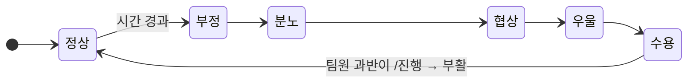

# 말꼬 (Malkko)

> 팀 채널의 협업 행동에 따라 체력이 오르내리는 **공동 마스코트 디스코드 봇**

팀프로젝트 단체방에 말꼬를 한 마리 키워요. 팀이 조용해지고 마감이 다가올수록 말꼬는 기력을 잃고, 팀원들이 진행 상황을 공유하면 다시 기운을 차려요. 잔소리하는 봇 대신 "같이 돌봐야 하는 캐릭터"가 대화를 이끄는 것이 목표예요.

- **언어 / 라이브러리**: Python, discord.py 2.x
- **DB**: SQLite + aiosqlite (파일 하나로 동작, 별도 설치 없음)
- **시연 목표**: 침묵 → 상태 악화 → 협업 행동 → 부활을 한 번에 보여주기

---

## 컨셉

말꼬의 체력(HP)은 시간이 지나면 줄어들고, 줄어든 만큼 다섯 단계를 거쳐 감정이 변해요 (애도의 5단계 모티프).



| 단계 | 체력 |
|---|---|
| 정상 | 84 ~ 100 |
| 부정 | 67 ~ 83 |
| 분노 | 50 ~ 66 |
| 협상 | 34 ~ 49 |
| 우울 | 17 ~ 33 |
| 수용 | 0 ~ 16 |

---

## 주요 기능

### 1. 시간이 지나면 약해져요 (악화)
- 프로젝트 기간의 **10%**를 `T`라 하고 (최소 48시간, 최대 168시간), 체력은 **시간당 `84 / T`** 씩 줄어요. 84는 체력 100에서 수용 단계(16 이하)에 진입하기까지의 양이에요.
- **마감이 가까워지면 빨라져요**: 남은 기간 25% 이하 ×1.5, 10% 이하 ×2.0. 마감일이 지나면 감소가 멈춰요.
- 스케줄러가 10초마다 모든 팀을 갱신해요. 봇이 꺼져 있던 시간은 다시 켤 때 한 번에 반영돼요.

### 2. 협업하면 회복해요
- `/진행`으로 한 줄 진행 상황을 공유하면 **체력 +15** (1인당 6시간에 1번).
- 회복 모션은 상황에 따라 달라져요: 협업 직후 *happy*, 단계가 올라가면 *healthy*, 부활하면 *shine*.
- 잡담은 회복이 없어요.

### 3. 수용 단계에서는 부활 미션만 열려요
- 수용 단계에 들어가면 `/진행`만 가능해요.
- 수용 진입 후 **등록된 팀원의 과반**이 진행을 공유하면 부활해요 (체력 100, 외형 레벨 2).
- 상태 카드에 부활 미션 진행도(예: `1/2명`)가 표시돼요.

### 4. 단계가 바뀔 때만 말을 걸어요
- 단계가 바뀔 때와 **가속 구간에 막 들어갈 때만** 채널에 알림(대사 + 상태 카드)을 보내요. 알림이 너무 잦아 피로해지는 걸 막기 위해서예요.
- 단계마다 대사가 달라요 (부정: "아직 별일 아니죠?", 분노: "진행 상황 좀 알려줘!" 등).

### 5. 잡담에는 잔소리해요
- `ㅋㅋ`, `ㅠㅠ`, `!!!`, 이모지처럼 **잡담으로만 이루어진 메시지**에 반응해요.
- 말꼬가 **분노 단계 이하**일 때만, 팀 기준 **1시간에 한 번** 잔소리해요.
- 메시지 분류 결과만 기록하고 **메시지 내용은 저장하지 않아요**. 분류 결과만으로는 체력이 바뀌지 않아요.
- 채널에 메시지를 쓴 사람은 자동으로 팀원으로 등록돼요.

### 6. 시연용 데모 모드
시간을 건너뛰어 악화와 부활을 빠르게 보여줄 수 있어요. 가상 시각은 팀별로 관리돼요.

---

## 명령어

코드에서는 영어 이름을 쓰고, 한국어 이름은 디스코드 언어가 한국어일 때 표시돼요 (`ko` 현지화).

| 한국어 | 영어 | 입력 | 설명 |
|---|---|---|---|
| `/말꼬-시작` | `/mascotstart` | 이름, 마감일, (시작일) | 이 채널에 말꼬를 만들고 상태 카드를 게시해요. 시작일을 비우면 오늘이에요. 채널 1개 = 팀 1개 |
| `/상태` | `/status` | | 단계, 체력, D-day, 악화 속도, 부활 미션 진행도를 보여줘요 |
| `/진행` | `/progress` | 내용 | 한 줄 진행 공유. 회복 +15, 1인당 6시간에 1번 |
| `/데모 건너뛰기` | `/demo skip` | 시간 | 지정한 시간만큼 지난 것으로 처리해요 |
| `/데모 마감` | `/demo deadline` | 남은일수 | 마감을 앞당겨 가속 구간을 바로 보여줘요 |
| `/데모 초기화` | `/demo reset` | | 체력 100·정상, 가상 시간과 마감일을 처음 상태로 되돌려요 |

- `/데모` 명령은 **서버 관리 권한**이 있는 사람에게만 보여요.
- 개발 확인용 `/ping`(봇과 DB 연결 확인)도 있어요.

---

## 동작 구조

```
디스코드 연결부 (cogs/, ui/)  →  코어 (core/)  →  저장소 (db/)
```

연결부가 저장소에서 캐릭터를 불러와 코어에 계산을 맡기고, 결과를 저장한 뒤 디스코드로 내보내요. **코어는 디스코드를 import하지 않아서** 디스코드 없이 단위 테스트할 수 있어요.

설계 원칙:

- **순수 함수 코어**: 현재 시각(`now`)을 인자로 받아서, 테스트에서 시간을 자유롭게 조작할 수 있어요.
- **가상 시각**: 게임 로직의 모든 시각은 팀별 가상 시계(`team.now()`)를 써요. 데모의 시간 건너뛰기가 감소와 쿨다운에 일관되게 반영돼요.
- **UTC 저장**: DB에는 UTC ISO 문자열로 저장하고 화면에서만 한국 시간(KST)으로 바꿔요. T와 가속 구간은 저장하지 않고 시작일·마감일로 그때그때 계산해요.
- **팀별 락**: 스케줄러와 명령어가 같은 팀의 체력을 동시에 바꿔도 덮어써지지 않아요.

### 코어 함수

| 함수 | 역할 |
|---|---|
| `stage_of(hp)` | 체력 → 단계 |
| `hours_to_acceptance(start, end)` | `T`: 기간의 10%, 48~168시간 |
| `speed_multiplier(start, end, now)` | 남은 25% 이하 1.5, 10% 이하 2.0, 마감 후 0 |
| `decay(m, team, now)` | 시간당 `84 / T` × 배수, 구간 경계에서 나눠 계산 |
| `apply_action(m, kind, now, ...)` | 협업 행동 반영, 수용 단계면 부활 조건 확인 |

### 폴더 구조

```
malkko/
├── bot.py               # 진입점: DB 연결, cog 로딩, 슬래시 명령 동기화
├── config.py            # .env, 시계(now), 규칙 초기값
├── core/                # 순수 로직 (디스코드 import 금지)
│   ├── state.py         # 단계 판정, 악화 속도, 감소
│   ├── actions.py       # 협업 행동 종류, 회복량, 쿨다운, 부활 판정
│   ├── messages.py      # 단계별·상황별 대사
│   ├── classify.py      # 메시지 분류 (A: 명백한 잡담)
│   └── policy.py        # 분류 결과에 따른 봇 행동 (잔소리 조건)
├── db/
│   ├── schema.sql       # 테이블 정의
│   └── repo.py          # 쿼리 함수
├── cogs/
│   ├── setup_cmd.py     # /말꼬-시작, /상태
│   ├── actions_cmd.py   # /진행
│   ├── listener.py      # 메시지 수신, 분류, 잔소리
│   ├── scheduler.py     # 주기적 감소, 단계 변경·가속 알림
│   ├── demo.py          # /데모
│   └── common.py        # 공용 함수 (감소 반영, 알림 전송)
├── ui/
│   ├── embeds.py        # 상태 카드
│   └── translator.py    # 한국어 명령어·단계 이름
├── adapters/            # 외부 연동 (AI 분류기 자리, 미구현)
├── assets/              # 캐릭터 이미지 (연결 예정)
└── tests/               # 단위 테스트
```

### DB 테이블

| 테이블 | 용도 |
|---|---|
| `teams` | 채널 1개 = 팀 1개, 기간, 데모 설정 |
| `members` | 팀원 등록 (부활 과반 계산) |
| `mascots` | 캐릭터 현재 상태 (체력, 외형 레벨, 부활 횟수 등) |
| `actions` | 협업 행동 기록 |
| `classifications` | 메시지 분류 기록 (내용은 저장 안 함) |

---

## 설치와 실행

### 1. 준비

- Python 3.10 이상 (개발 환경: Python 3.14)
- [Discord Developer Portal](https://discord.com/developers/applications)에서 애플리케이션과 봇을 만들고 토큰을 발급받아요.
  - Bot 탭에서 **Message Content Intent**를 켜요 (잡담 분류에 필요해요).
  - 서버에 초대할 때 scope는 `bot`, `applications.commands`를 모두 선택하고, 권한은 메시지 보내기 / 임베드 링크 / 메시지 기록 보기를 줘요.

### 2. 설치

```bash
python -m venv .venv
# Windows
.venv\Scripts\activate
# macOS / Linux
source .venv/bin/activate

pip install -r requirements.txt
```

`requirements.txt`

```
discord.py>=2.4
aiosqlite
python-dotenv
tzdata
pytest
```

### 3. 환경 변수

프로젝트 루트에 `.env` 파일을 만들어요.

```
DISCORD_TOKEN=봇_토큰
DEV_GUILD_ID=테스트_서버_ID   # 선택: 개발 중 이 서버에 슬래시 명령을 즉시 동기화
DB_PATH=malkko.db             # 선택
```

> ⚠️ `.env`와 DB 파일은 절대 GitHub에 올리지 마세요. `.gitignore`에 아래를 넣어요. 토큰이 올라갔다면 즉시 재발급하세요.
>
> ```
> .env
> *.db
> *.db-wal
> *.db-shm
> .venv/
> __pycache__/
> ```

### 4. 실행

```bash
python bot.py
```

처음 실행하면 `db/schema.sql`로 테이블이 자동으로 만들어져요. 콘솔에 `loaded cogs.…`, `synced N commands`가 나오면 준비 완료예요.

### 5. 테스트

```bash
pytest -q
```

---

## 시연 순서 (예시)

4주짜리 프로젝트 기준이에요 (시간당 -1.25).

1. `/말꼬-시작 이름: 말꼬 마감일: …` 후 `/상태`로 정상 상태 보여주기
2. `/데모 건너뛰기 시간: 14` → 정상 → 부정, `시간: 16` → 분노 알림
3. 채팅에 `ㅋㅋ` 입력 → 말꼬의 잔소리
4. `/데모 마감 남은일수: 2` → 가속 ×2 알림
5. `/데모 건너뛰기`를 이어서 → 협상, 우울, 수용 (부활 미션 안내)
6. 팀원들이 `/진행`으로 진행 공유 → 과반이 되면 부활
7. 리허설 후에는 `/데모 초기화`

---

## 구현 현황

- [x] 핵심 규칙 (단계 판정, 악화, 가속, 회복, 부활) + 단위 테스트
- [x] `/말꼬-시작`, `/상태`, `/진행`, `/데모`
- [x] 스케줄러와 단계 변경·가속 알림
- [x] 잡담 분류(A)와 잔소리, 분류 기록
- [ ] 단계별 캐릭터 이미지(GIF)와 모션 연결
- [ ] `/막힘` (막힘 요청과 도움)
- [ ] `/회의-투표`
- [ ] `/설정` (기간 변경)
- [ ] 키워드 분류(B)로 버튼 제안, AI 분류(C)
- [ ] `/데모 배속`
