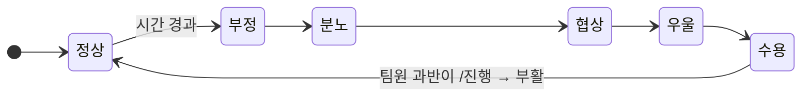

# 말꼬 (Malkko)

> 팀 채널의 협업 행동에 따라 체력이 오르내리는 **공동 마스코트 디스코드 봇**

팀프로젝트 단체방에 말꼬를 한 마리 키워요. 팀이 조용해지고 마감이 다가올수록 말꼬는 기력을 잃고, 팀원들이 진행 상황을 공유하거나 서로 돕고 함께 결정하면 다시 기운을 차려요. 잔소리하는 봇 대신 "같이 돌봐야 하는 캐릭터"가 대화를 이끄는 것이 목표예요.

- **언어 / 라이브러리**: Python, discord.py 2.x (2.4 이상)
- **DB**: SQLite + aiosqlite (파일 하나로 동작, 별도 설치 없음)
- **시연 목표**: 침묵 → 상태 악화 → 협업 행동 → 부활을 한 번에 보여주기

---

## 컨셉

말꼬의 체력(HP)은 시간이 지나면 줄어들고, 줄어든 만큼 다섯 단계를 거쳐 감정이 변해요 (애도의 5단계 모티프). 단계마다 다른 캐릭터 이미지와 대사가 나와요.



| 단계 | 체력 | 이미지 파일 |
|---|---|---|
| 정상 | 84 ~ 100 | `normal` |
| 부정 | 67 ~ 83 | `denial` |
| 분노 | 50 ~ 66 | `anger` |
| 협상 | 34 ~ 49 | `bargaining` |
| 우울 | 17 ~ 33 | `depression` |
| 수용 | 0 ~ 16 | `acceptance` |

---

## 주요 기능

### 1. 시간이 지나면 약해져요 (악화)
- 프로젝트 기간의 **10%**를 `T`라 하고 (최소 48시간, 최대 168시간), 체력은 **시간당 `84 / T`** 씩 줄어요. 84는 체력 100에서 수용 단계(16 이하)에 진입하기까지의 양이에요.
- **마감이 가까워지면 빨라져요**: 남은 기간 25% 이하 ×1.5, 10% 이하 ×2.0. 마감일이 지나면 감소가 멈춰요.
- 스케줄러가 10초마다 모든 팀을 갱신해요. 봇이 꺼져 있던 시간은 다시 켤 때 한 번에 반영돼요.

### 2. 협업하면 회복해요

| 행동 | 회복 | 제한 |
|---|---|---|
| `/진행` 진행 공유 | **+15** | 1인당 6시간에 1번 |
| `/막힘` 도움 요청 | **+5** | 1인당 1시간에 1번 |
| 막힘 요청에 🙋 도와줄게 | **+20** | 요청 1건에 1명, 요청자 본인은 불가 |
| `/회의-투표` 처음 투표 | **+10** | 투표당 1회, 1인당 1시간에 1번 |
| 등록된 팀원 **전원**이 투표 | **+20** | 투표당 1회 |

- 체력은 최대 100이고, 잡담은 회복이 없어요.
- 회복 모션은 상황에 따라 달라져요: 협업 직후 *happy*, 단계가 올라가면 *healthy*, 부활하면 *shine* (현재는 😆 💪 ✨ 이모지로 표시).

### 3. 수용 단계에서는 부활 미션만 열려요
- 수용 단계에 들어가면 `/진행`만 체력에 반영돼요. `/막힘`과 도와줄게는 막히고, 투표는 할 수 있지만 체력 보상이 없어요.
- 수용 진입 후 **등록된 팀원의 과반**이 진행을 공유하면 부활해요 (체력 100, 외형 레벨 2).
- 상태 카드에 부활 미션 진행도(예: `1/2명`)가 표시돼요.

### 4. 단계가 바뀔 때만 말을 걸어요
- 단계가 바뀔 때와 **가속 구간에 막 들어갈 때만** 채널에 알림(대사 + 상태 카드)을 보내요. 알림이 너무 잦아 피로해지는 걸 막기 위해서예요.
- 단계마다 대사가 달라요 (부정: "아직 별일 아니죠?", 분노: "진행 상황 좀 알려줘!" 등).

### 5. 잡담만 반복하면 잔소리해요
- `ㅋㅋ`, `ㅠㅠ`, `!!!`, 이모지처럼 **잡담으로만 이루어진 메시지**가 이어지는지 실시간으로 지켜봐요.
- 말꼬가 **분노 단계 이하**일 때, 잡담만 **3번 연속**(여러 사람이 이어서 쳐도 팀 합산) 이어지면 잔소리해요. 팀 기준 **1시간에 한 번**만 해요.
- 글자가 섞인 **진짜 대화**나 첨부 파일이 한 번이라도 나오면 횟수가 초기화되고, 잡담 사이가 10분을 넘으면 새로 세요.
- 분류 결과만으로는 체력이 바뀌지 않아요. 채널에 메시지를 쓴 사람은 자동으로 팀원으로 등록돼요.
- 연속 횟수·간격·시작 단계는 `core/policy.py` 맨 위 상수(`NAG_STREAK`, `STREAK_WINDOW`, `NAG_COOLDOWN`, `NAG_FROM_STAGE`)로 조절해요.

### 6. 단계별 캐릭터 이미지
- `assets/`의 이미지를 상태 카드와 알림 카드에 **큰 이미지**로 보여줘요. 파일이 없는 단계는 이모지 카드로 대신 나와서, 일부만 있어도 동작해요.
- 부활 후 외형은 `_lv2` 파일을 따로 두면 적용돼요 (없으면 기본 이미지).
- 시작할 때 연결된 이미지 수, 빠진 단계, 2MB 초과 파일을 로그로 알려줘요.

### 7. 시연용 데모 모드
시간을 건너뛰어 악화와 부활을 빠르게 보여줄 수 있어요. 가상 시각은 팀별로 관리돼요.

---

## 명령어

코드에서는 영어 이름을 쓰고, 한국어 이름은 디스코드 언어가 한국어일 때 표시돼요 (`ko` 현지화).

| 한국어 | 영어 | 입력 | 설명 |
|---|---|---|---|
| `/말꼬-시작` | `/mascotstart` | 이름, 마감일, (시작일) | 이 채널에 말꼬를 만들고 상태 카드를 게시해요. 시작일을 비우면 오늘이에요. 채널 1개 = 팀 1개 |
| `/상태` | `/status` | | 단계, 체력, D-day, 악화 속도, 부활 미션 진행도를 보여줘요 |
| `/진행` | `/progress` | 내용 | 한 줄 진행 공유. 회복 +15, 1인당 6시간에 1번 |
| `/막힘` | `/stuck` | 내용 | 막힌 내용을 요청 카드로 공유해요. 요청 시 +5, 다른 팀원이 🙋 도와줄게를 누르면 +20 |
| `/회의-투표` | `/meeting-vote` | 제목, 후보1~5, 마감, (중복선택) | 투표 카드를 올려요. 처음 투표하면 +10, 전원 투표 시 +20. 마감되면 자동으로 닫히고 결과를 알려줘요 |
| `/설정` | `/settings` | (시작일), (마감일) | 값 없이 쓰면 현재 설정을 나만 보이게 보여주고, 넣으면 기간을 바꿔요 |
| `/데모 건너뛰기` | `/demo skip` | 시간 | 지정한 시간만큼 지난 것으로 처리해요 |
| `/데모 마감` | `/demo deadline` | 남은일수 | 마감을 앞당겨 가속 구간을 바로 보여줘요 |
| `/데모 초기화` | `/demo reset` | | 체력 100·정상, 가상 시간과 마감일을 처음 상태로 되돌려요 |

개발 확인용 `/ping`(봇과 DB 연결 확인)도 있어요.

### `/막힘` 자세히
- 요청 카드에 🙋 **도와줄게** 버튼이 붙어요. 가장 먼저 누른 팀원이 도와주는 사람이 되고, 카드는 "도움 받는 중"으로 바뀌며 버튼이 꺼져요.
- 요청자는 자기 요청에 도와줄게를 누를 수 없어요. 수용 단계에서는 `/막힘`과 도와줄게 모두 막혀요.
- 봇을 재시작해도 이전 카드의 버튼이 계속 동작해요.

### `/회의-투표` 자세히
- 후보는 2~5개이고, **중복선택**을 켜면 여러 개를 고를 수 있어요. 한 개만 선택일 때는 같은 버튼을 다시 누르면 투표가 취소돼요.
- 마감 입력: `30분`, `2시간`, `1일`(또는 `30m`, `2h`, `1d`), `18:00`(다음에 오는 그 시각), `11-25 18:00`, `2026-11-25 18:00` (한국 시간). 최소 1분 뒤, 최대 30일 이내예요.
- 마감은 **실제 시각** 기준이에요 (데모의 시간 건너뛰기와 무관). 마감되면 최대 10초 안에 버튼이 사라지고 👑 결과가 표시돼요. 봇이 꺼져 있는 동안 마감된 투표는 다시 켤 때 닫혀요.

### `/설정` 자세히
- 시작일·마감일 중 하나만 바꿔도 돼요. 변경 전 → 변경 후를 공개 카드로 보여줘서 누가 바꿨는지 남아요.
- **체력은 회복되지 않아요.** 바꾸기 전까지의 감소는 기존 기간 기준으로 먼저 확정하고, 앞으로의 악화 속도와 가속 구간만 새 기간으로 계산돼요.
- 데모 모드(시간 건너뛰기) 중에는 바꿀 수 없어요. `/데모 초기화` 후에 바꿔 주세요.

### 권한
- `/데모`는 **서버 관리 권한**이 있는 사람에게만 보여요.

---

## 동작 구조

```
디스코드 연결부 (cogs/, ui/)  →  코어 (core/)  →  저장소 (db/)
```

연결부가 저장소에서 캐릭터를 불러와 코어에 계산을 맡기고, 결과를 저장한 뒤 디스코드로 내보내요. **코어는 디스코드를 import하지 않아서** 디스코드 없이 단위 테스트할 수 있어요.

설계 원칙:

- **순수 함수 코어**: 현재 시각(`now`)을 인자로 받아서, 테스트에서 시간을 자유롭게 조작할 수 있어요.
- **가상 시각**: 게임 로직의 모든 시각은 팀별 가상 시계(`team.now()`)를 써요. 데모의 시간 건너뛰기가 감소와 쿨다운에 일관되게 반영돼요. (투표 마감만 실제 시각)
- **UTC 저장**: DB에는 UTC ISO 문자열로 저장하고 화면에서만 한국 시간(KST)으로 바꿔요. T와 가속 구간은 저장하지 않고 시작일·마감일로 그때그때 계산해요.
- **팀별 락**: 스케줄러, 명령어, 버튼이 같은 팀의 체력을 동시에 바꿔도 덮어써지지 않아요.
- **재시작해도 버튼 유지**: 막힘·투표 버튼은 요청마다 고유한 `custom_id`를 쓰는 `DynamicItem`이라 봇을 껐다 켜도 동작해요.

### 코어 함수

| 함수 | 역할 |
|---|---|
| `stage_of(hp)` | 체력 → 단계 |
| `hours_to_acceptance(start, end)` | `T`: 기간의 10%, 48~168시간 |
| `speed_multiplier(start, end, now)` | 남은 25% 이하 1.5, 10% 이하 2.0, 마감 후 0 |
| `decay(m, team, now)` | 시간당 `84 / T` × 배수, 구간 경계에서 나눠 계산 |
| `apply_action(m, kind, now, ...)` | 협업 행동 반영, 수용 단계면 부활 조건 확인 |

### 폴더 구조

```
malkko/
├── bot.py               # 진입점: DB 연결, cog 로딩, 슬래시 명령 동기화
├── config.py            # .env, 시계(now), 규칙 초기값
├── requirements.txt
├── core/                # 순수 로직 (디스코드 import 금지)
│   ├── state.py         # 단계 판정, 악화 속도, 감소
│   ├── actions.py       # 협업 행동 종류, 회복량, 쿨다운, 부활 판정
│   ├── messages.py      # 단계별·상황별 대사
│   ├── classify.py      # 메시지 분류 (A: 명백한 잡담)
│   ├── policy.py        # 분류 결과에 따른 봇 행동 (잔소리 조건)
│   └── voting.py        # 마감 입력 해석, 투표 선택·집계
├── db/
│   ├── schema.sql       # 테이블 정의
│   └── repo.py          # 쿼리 함수
├── cogs/
│   ├── setup_cmd.py     # /말꼬-시작, /상태
│   ├── actions_cmd.py   # /진행
│   ├── stuck_cmd.py     # /막힘 + 도와줄게 버튼
│   ├── meeting_cmd.py   # /회의-투표 + 투표 버튼, 마감 처리
│   ├── settings_cmd.py  # /설정
│   ├── listener.py      # 메시지 수신, 분류, 잔소리
│   ├── scheduler.py     # 주기적 감소, 단계 변경·가속 알림
│   ├── demo.py          # /데모
│   └── common.py        # 공용 함수 (감소 반영, 알림 전송)
├── ui/
│   ├── embeds.py        # 상태·막힘·투표·설정 카드
│   ├── images.py        # 단계별 캐릭터 이미지 찾기·첨부
│   └── translator.py    # 한국어 명령어·단계 이름
├── adapters/            # 외부 연동 (AI 분류기 자리, 미구현)
├── assets/              # 캐릭터 이미지
└── tests/               # 단위 테스트
```

### DB 테이블

| 테이블 | 용도 |
|---|---|
| `teams` | 채널 1개 = 팀 1개, 기간, 데모 설정 |
| `members` | 팀원 등록 (부활 과반, 전원 투표 계산) |
| `mascots` | 캐릭터 현재 상태 (체력, 외형 레벨, 부활 횟수 등) |
| `actions` | 협업 행동 기록 |
| `classifications` | 메시지 분류 기록 (메시지 내용은 저장 안 함) |
| `stuck_requests` | 막힘 요청과 도와주는 사람 |
| `votes` | 회의 투표 (후보, 마감, 중복 여부) |
| `vote_responses` | 투표 응답 |

---

## 설치와 실행

### 1. 준비

- Python 3.10 이상
- [Discord Developer Portal](https://discord.com/developers/applications)에서 애플리케이션과 봇을 만들고 토큰을 발급받아요.
  - Bot 탭에서 **Message Content Intent**를 켜요 (잡담 분류에 필요해요).

### 2. 설치

```bash
python -m venv .venv
# Windows
.venv\Scripts\activate
# macOS / Linux
source .venv/bin/activate

python -m pip install -r requirements.txt
```

`requirements.txt`

```
discord.py>=2.4
aiosqlite
python-dotenv
tzdata
pytest
```

> 가상환경(`.venv`)은 GitHub에 올라가지 않아요. 다른 컴퓨터로 옮기면 위 과정을 다시 해야 해요. `pip` 대신 `python -m pip`를 쓰면 지금 쓰는 파이썬에 정확히 설치돼요.

### 3. 환경 변수

프로젝트 루트에 `.env` 파일을 만들어요. 따옴표와 `=` 앞뒤 공백 없이, 주석은 별도 줄에 써요.

| 변수 | 필수 | 설명 |
|---|---|---|
| `DISCORD_TOKEN` | 필수 | 봇 토큰 |
| `SYNC_SCOPE` | 선택 | `global`: 봇이 들어간 모든 서버에서 사용 / `guild`: 개발용, `DEV_GUILD_ID` 서버에만 즉시 반영. 비우면 `DEV_GUILD_ID`가 있을 때 `guild`, 없으면 `global` |
| `DEV_GUILD_ID` | 선택 | 개발 서버의 숫자 ID. `guild`에서는 필수이고, `global`에서는 예전 서버 전용 명령을 한 번 정리하는 데 써요 (명령이 두 번 뜨는 것 방지) |
| `DB_PATH` | 선택 | DB 파일 경로 (기본 `malkko.db`) |
| `CHARACTER_KEY` | 선택 | 이미지 파일명 앞부분 (기본 `malkko`) |

```
DISCORD_TOKEN=실제_봇_토큰
SYNC_SCOPE=global
DEV_GUILD_ID=123456789012345678
CHARACTER_KEY=malkko
```

> ⚠️ `.env`와 DB 파일은 절대 GitHub에 올리지 마세요. `.gitignore`에 아래를 넣어요. 토큰이 올라갔다면 디스코드가 자동으로 무효화할 수 있으니 Developer Portal에서 **Reset Token**으로 재발급하고, `git rm --cached .env`로 추적을 해제하세요.
>
> ```
> .env
> *.db
> *.db-wal
> *.db-shm
> .venv/
> __pycache__/
> ```

### 4. 실행

```bash
python bot.py
```

처음 실행하면 `db/schema.sql`로 테이블이 자동으로 만들어져요. 콘솔에 `loaded cogs.…`, `캐릭터 이미지 N/6개 연결됨`, `synced N … commands`가 나오면 준비 완료예요. 코드나 이미지를 바꾼 뒤에는 봇을 껐다가 다시 실행해야 반영돼요.

### 5. 테스트

```bash
pytest -q
```

상태·감소, 행동·부활, 저장소, 분류·잔소리 정책, 투표, 이미지 찾기를 검증해요. 테스트는 `.env`(봇 토큰) 없이도 실행돼요.

---

## 캐릭터 이미지 넣기

1. 피그마에서 단계별 프레임 6개를 만들고, **프레임 이름을 파일명으로** 지어요: `malkko_normal`, `malkko_denial`, `malkko_anger`, `malkko_bargaining`, `malkko_depression`, `malkko_acceptance`.
2. 가로로 넓은 비율(예: 960×540), 투명 배경, 캐릭터가 프레임을 꽉 채우도록 하면 카드에서 더 크게 보여요.
3. 6개를 선택해 **PNG, 1x**로 내보내요 (배율 접미사 `@2x`가 붙지 않게 주의). 하나당 2MB 이하예요.
4. 파일을 `assets/` 폴더에 넣고 봇을 재시작해요. `.png`, `.gif`, `.webp`를 모두 지원해요.
5. 부활 후 외형은 `malkko_normal_lv2.png`처럼 `_lv2`를 붙여요. 없는 파일은 기본 이미지나 이모지로 대신 나와요.

---

## 여러 서버에서 사용하기

`SYNC_SCOPE=global`이면 봇이 들어간 모든 서버에서 명령어가 보이고, 서버·채널마다 독립된 말꼬가 생겨요.

1. Developer Portal → **Bot** 탭에서 **Public Bot**을 켜요 (Requires OAuth2 Code Grant는 꺼요).
2. **Installation** 탭의 Guild Install에서 scope `bot`, `applications.commands`와 아래 권한을 선택해요.
   - 채널 보기, 메시지 보내기, 임베드 링크, 파일 첨부(캐릭터 이미지에 필요), 메시지 기록 보기
3. 초대 링크는 Installation 탭의 Install Link를 쓰거나 직접 만들어요 (권한 값 `117760`).
   ```
   https://discord.com/oauth2/authorize?client_id=<APPLICATION_ID>&scope=bot%20applications.commands&permissions=117760
   ```
4. 서버가 100개 이상으로 커지면 Message Content Intent는 디스코드의 인증·승인이 필요해요.

> 봇은 **`bot.py`가 실행 중일 때만** 응답해요. 계속 쓰려면 꺼지지 않는 컴퓨터나 서버에서 돌리고, `malkko.db`와 `assets/`가 재시작 후에도 유지되는 곳에 두세요. 개발 중에는 개발용 봇을 따로 만들어 `SYNC_SCOPE=guild`로 테스트하면 운영 중인 봇과 섞이지 않아요.

---

## 저장하는 데이터

- **일반 채팅 메시지의 내용은 저장하지 않아요.** 팀 채널의 메시지는 잡담 여부만 판단하고, `classifications`에는 분류 결과와 규칙 이름만 남겨요.
- 슬래시 명령으로 **직접 입력한 내용**(`/진행` 진행 내용, `/막힘` 막힌 내용, 투표 제목·후보)은 기능을 위해 저장해요.
- 팀원 등록을 위해 사용자 ID와 표시 이름을 저장해요.
- 말꼬가 없는 채널의 메시지는 무시해요.

---

## 시연 순서 (예시)

4주짜리 프로젝트 기준이에요 (시간당 -1.25).

1. `/말꼬-시작 이름: 말꼬 마감일: …` 후 `/상태`로 정상 상태 보여주기
2. `/데모 건너뛰기 시간: 14` → 정상 → 부정, `시간: 16` → 분노 알림
3. 채팅에 `ㅋㅋ`, `ㅠㅠ`, `😂`를 **3번 연속** 입력 → 말꼬의 잔소리
4. `/데모 마감 남은일수: 2` → 가속 ×2 알림
5. `/데모 건너뛰기`를 이어서 → 협상, 우울, 수용 (부활 미션 안내)
6. (선택) `/막힘`과 `/회의-투표`로 협업 회복을 보여주기 — 단, 수용 단계 **전**에
7. 팀원들이 `/진행`으로 진행 공유 → 과반이 되면 부활
8. 리허설 후에는 `/데모 초기화`

> 부활에는 **등록된 팀원의 과반**이 필요해요. 시연 채널에서 채팅하거나 명령을 쓴 사람은 모두 팀원으로 등록돼서 필요 인원이 늘어나니 참고하세요.

---

## 구현 현황

- [x] 핵심 규칙 (단계 판정, 악화, 가속, 회복, 부활) + 단위 테스트
- [x] `/말꼬-시작`, `/상태`, `/진행`, `/막힘`, `/회의-투표`, `/설정`, `/데모`
- [x] 스케줄러와 단계 변경·가속 알림
- [x] 잡담 분류(A)와 연속 잔소리, 분류 기록
- [x] 단계별 캐릭터 이미지 (큰 이미지 카드, 이모지 대체, `_lv2` 외형)
- [x] 모든 서버에서 쓰는 전역 명령 등록 (`SYNC_SCOPE`)
- [ ] 회복 모션 이미지 (happy, healthy, shine — 현재 이모지)
- [ ] 키워드 분류(B)로 버튼 제안, AI 분류(C)
- [ ] `/데모 배속`
